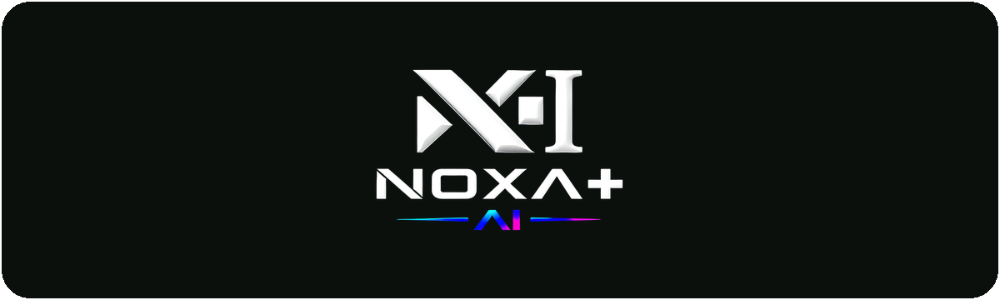
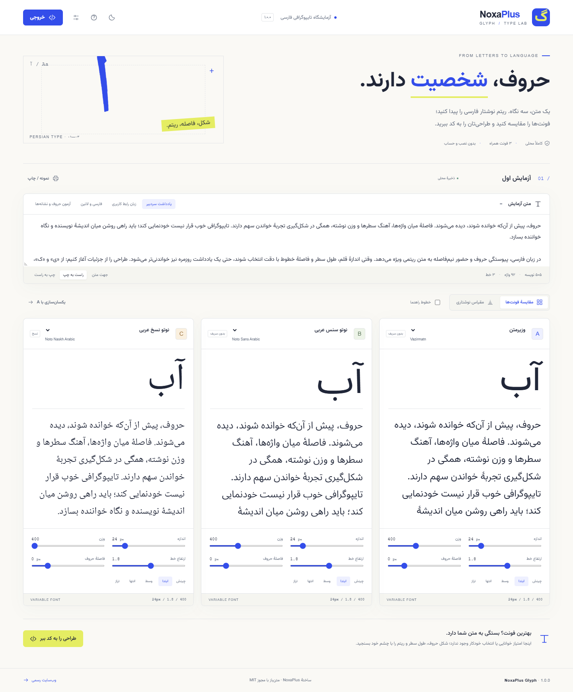

<p align="center"></p>

# NoxaPlus Glyph

**A local-first Persian typography lab: one text, three perspectives.**

NoxaPlus Glyph is a public, open-source browser application by **NoxaPlus**. Compare three embedded variable fonts, tune independent specimens, build a modular type scale, and export your decisions as CSS, a self-contained HTML specimen, or a restorable JSON project. The interface is Persian and right-to-left; this documentation is in English.

**Version:** 1.0.1 · **Release date:** 2026-11-16 · **Application license:** MIT

[Open NoxaPlus Glyph](https://noxaplus-star.github.io/noxaplus-glyph/) · [GitHub repository](https://github.com/noxaplus-star/noxaplus-glyph) · [Official NoxaPlus website](https://www.noxaplus.ir) · [Contact NoxaPlus](mailto:NoxaPlus2025@gmail.com)



## Quick start: double-click and experiment

1. Download and extract the repository ZIP from [GitHub](https://github.com/noxaplus-star/noxaplus-glyph).
2. Double-click **`index.html` at the repository root** to open the ready-to-use application in a modern browser. No Node.js, server, account, or installation is required for this route.
3. Choose a sample or paste your own text. Adjust cards A, B, and C, or switch to the modular-scale view.
4. Wait for the local-save indicator to finish. Download a JSON backup before closing if a storage warning appears.

The root `index.html` is the generated standalone build distributed with the repository; its application code, styles, and fonts are embedded. **`app/index.html` is the development source entry, not the double-click application.** Do not hand-edit the generated root file.

Prefer the [hosted application](https://noxaplus-star.github.io/noxaplus-glyph/) if your browser restricts local-file storage. Loading it initially requires network access; offline use becomes available after its service worker successfully caches the application.

## Features

| Feature | What NoxaPlus Glyph provides |
| --- | --- |
| Persian-first workspace | Persian RTL interface, with independent RTL or LTR direction for the shared sample text. |
| Embedded fonts | Vazirmatn, Noto Sans Arabic, and Noto Naskh Arabic; no runtime font-CDN requests. |
| Three comparison cards | Exactly three specimens, A/B/C, each with its own font, size, weight, line height, letter spacing, and alignment. |
| Font size | 12–96 px on each comparison card. |
| Variable weight | Vazirmatn and Noto Sans Arabic: 100–900; Noto Naskh Arabic: 400–700. UI weight controls use increments of 100. |
| Line height | Unitless 1–2.5, adjustable in increments of 0.05. |
| Letter spacing | −1–4 px, adjustable in increments of 0.1; nonzero spacing can affect Arabic-script joining. |
| Alignment | Logical start, center, logical end, or justify. Start/end follow the sample direction. |
| Synchronize with A | Copies size, weight, line height, spacing, and alignment from A to all cards, preserving each card's font and clamping weights to its font's range. |
| Shared text editor | Prepared samples, editable text up to 50,000 UTF-16 code units, collapsible editor, and character/word/line counters. |
| Modular scale | Eight steps from caption to h1, base 12–24 px, six preset ratios, and a separate font/weight selection. |
| Visual guides | Optional guides for comparing rhythm and scale; not a font-metrics or glyph-coverage analysis. |
| CSS export | Reusable custom properties and specimen/scale classes; copy or download. Font files are not included. |
| HTML specimen | Current-view specimen with all three fonts, font-license notices, escaped text, and print styling; no executable scripts. |
| JSON backup | A versioned project containing text, title, direction, all cards, scale, theme, and selected view. Valid import requires confirmation before replacement. |
| Local persistence | Autosave after a 250 ms pause, guarded by Web Locks and exact saved-snapshot comparison; warnings pause unsafe writes. |
| Recovery safeguards | Invalid stored data is retained verbatim for download rather than silently overwritten; explicitly confirmed import/reset can repair it while retaining snapshot conflict checks. |
| Appearance and controls | Light/dark themes, responsive layouts, labeled controls, visible keyboard focus, modal focus management, status messages, and reduced-motion styling. |
| Offline and installation | Standalone `file://` use; service-worker caching and browser-menu PWA installation on supported HTTPS/localhost browsers. |
| Privacy | No account, analytics, text uploads, AI service, or automatic third-party runtime requests. |

Accessibility features are implementation aids, not a claim of audited compliance. Browser rendering, storage, printing, and installation support vary; not every browser has been verified.

## Compare typography

The same sample text appears in all three comparison cards. Font choice and typographic controls remain independent until you choose **Synchronize with A**. Changing a font clamps that card's existing weight to the newly selected font's supported range.

The initial project uses one of each embedded font, 24 px size, weight 400, line height 1.8, zero letter spacing, start alignment, RTL text, and the light theme. Reset restores the initial experiment while retaining the current theme.

Use actual content, including punctuation, numbers, and zero-width non-joiners, rather than judging a font from a decorative heading alone. The application does not normalize or automatically correct your sample. Nonzero letter spacing may change Persian/Arabic letter joining in some browsers; start with **0 px** when evaluating connected text.

The displayed character counter counts Unicode code points, whereas the editor/import limit uses UTF-16 code units. Some characters consume two code units; the displayed count is therefore not always the remaining-capacity measure. Word counts use whitespace splitting and are not linguistic segmentation.

## Modular scale: math and units

Choose a base size from **12–24 px** and one of these ratios:

| Ratio | Label |
| --- | --- |
| 1.125 | Major Second |
| 1.2 | Minor Third |
| 1.25 | Major Third |
| 1.333 | Perfect Fourth |
| 1.414 | Augmented Fourth |
| 1.5 | Perfect Fifth |

The stored numeric values are used directly, including the rounded presets 1.333 and 1.414.

```text
pixels = round(base × ratio^exponent, 2 decimal places)
rem    = round(pixels / 16, 4 decimal places)
```

| Step | Exponent | Default pixels: base 16, ratio 1.25 | Exported rem |
| --- | ---: | ---: | ---: |
| caption | -1 | 12.8 | 0.8 |
| body | 0 | 16 | 1 |
| h6 | 1 | 20 | 1.25 |
| h5 | 2 | 25 | 1.5625 |
| h4 | 3 | 31.25 | 1.9531 |
| h3 | 4 | 39.06 | 2.4413 |
| h2 | 5 | 48.83 | 3.0519 |
| h1 | 6 | 61.04 | 3.815 |

**The live scale preview uses pixel sizes; exported scale classes use rem.** The conversion assumes a 16 px root. A destination site with a different root font size will render a different physical size, and rounding can introduce tiny differences even at 16 px. Comparison-card classes retain pixel sizes.

The UI scale preview and exported caption/heading samples use the **first nonempty sample line**, skipping leading blank lines. Both show the complete sample in the body step. When there is no nonempty line, the compact samples remain empty.

## Exports

### CSS: bring your own font loading

The stylesheet includes both comparison-card settings and the modular scale, regardless of which view is currently open. It contains **no font files, `@font-face` declarations, or remote font imports**. Load the relevant font families in your destination project under the names `Vazirmatn`, `Noto Sans Arabic`, and `Noto Naskh Arabic`, retaining their font licenses.

Save the CSS export as `typography.css`, link it from your page, and apply its actual class names:

```html
<link rel="stylesheet" href="typography.css">

<!-- Load the selected font families separately before using these classes. -->
<section lang="fa" dir="rtl">
  <h1 class="glyph-type-h1">Your heading text</h1>
  <p class="glyph-type-body">Your complete sample text</p>
  <p class="glyph-type-caption">Your caption text</p>

  <div class="glyph-specimen-a">Sample using card A settings</div>
  <div class="glyph-specimen-b">Sample using card B settings</div>
  <div class="glyph-specimen-c">Sample using card C settings</div>
</section>
```

Replace the example English strings with your content. Exported classes set the project's selected sample direction; the `dir` attributes above illustrate an RTL project, not an override for an LTR export.

- Card classes: `.glyph-specimen-a`, `.glyph-specimen-b`, `.glyph-specimen-c`.
- Scale classes: `.glyph-type-caption`, `.glyph-type-body`, `.glyph-type-h6` through `.glyph-type-h1`.
- Card tokens: `--glyph-a-font`, `--glyph-a-size`, `--glyph-a-weight`, `--glyph-a-line-height`, `--glyph-a-letter-spacing`, with matching `b`/`c` tokens. Alignment and direction are declarations in the classes, not separate tokens.
- Scale tokens: `--glyph-scale-font`, `--glyph-scale-weight`, and `--glyph-caption`, `--glyph-body`, `--glyph-h6` through `--glyph-h1`.

For your own selector, use a token such as `font-size: var(--glyph-h2)`. The supplied scale classes also set line height to 1.65 for body/caption and 1.35 for headings, normal letter spacing, and start alignment. Check your site's other CSS for overrides and missing-font fallbacks.

### HTML: self-contained viewing and printing

HTML export captures the **current view**: all three cards in comparison mode, or all eight scale steps in scale mode. It includes the project title, sample text, settings, all three embedded fonts, and their SIL Open Font License notices. It is a light, print-oriented specimen, not a full interactive application or a theme-identical screenshot.

User text and titles are HTML-escaped. The exported specimen has no executable scripts and does not automatically request external fonts or other third-party resources. Its official-site link opens an external site only if you follow it.

Use **Specimen / Print** or the export dialog's preview action to open the specimen. If a browser blocks the new tab, download the HTML and open it directly.

To produce a PDF, use the **browser's Print command** in the specimen tab (`Ctrl+P` / `Cmd+P`) and select the browser/operating system's PDF destination if available. Pagination, margins, headers, and PDF availability depend on the browser. NoxaPlus Glyph has **no custom PDF engine or direct PDF exporter**.

### JSON: restore the editable project

Use Project Management to download a JSON backup or select one to import. **JSON is the only restorable project format**; CSS and specimen HTML cannot be imported as editable projects.

The format has an outer envelope with `app: "NoxaPlus Glyph"`, `version: 1`, and `project`. The enclosed project also has schema `version: 1`; this is distinct from application release 1.0.0. Import validates titles, text length, enums, exactly three unique cards, numeric ranges, and supported fonts/ratios.

The file-input limit is **2 MiB (2,097,152 bytes)**. Invalid files are rejected; a valid import is staged until you explicitly confirm replacement. Import replaces the current project rather than merging it. Download your current JSON first if you want to keep both experiments.

## Local storage, conflicts, and recovery

There is one current project per browser storage context, saved in `localStorage` under `noxaplus-glyph-project-v1`. There is no project library, history browser, multi-project workspace, cloud sync, or account-based recovery. Keep separate JSON files for separate experiments.

Autosave waits for a **250 ms pause** and uses the browser's **Web Locks API** to coordinate writes. Before saving, it compares the current stored string with the exact raw snapshot previously read by that tab. Even equivalent JSON with different formatting is a different revision. A changed snapshot or a storage event from another tab stops saving instead of silently overwriting newer data; this is conflict detection, not collaborative editing or merging.

- **Before closing:** wait until saving completes; download JSON whenever persistence is uncertain. Page-exit saving is best effort, not a backup guarantee.
- **Another-tab warning:** download this tab's JSON, stop editing competing tabs, then reload to read the saved project. Restore your backup only after checking which version you want to retain.
- **Invalid stored data:** autosave pauses and the raw original remains available through the warning's recovery download. Download both the raw prior data and the current JSON before recovery. An explicitly confirmed valid import or reset authorizes replacement of retained invalid data, while preserving the exact-snapshot conflict check. Repair still requires working storage and Web Locks; if a warning persists, keep the backups and report the issue rather than deleting data blindly.
- **Unavailable storage or Web Locks:** editing and downloads remain useful, but safe autosave is unavailable. Use JSON backups and try an up-to-date browser on HTTPS or localhost.

Storage is tied to the origin, browser, and profile. `file://` storage behavior is browser-dependent; moving/renaming the root HTML file or opening a different copy may expose a different storage context. Private browsing, storage quotas, browser cleanup, and device loss can remove data. Export JSON before moving files, changing browsers, or clearing site data.

## Offline use and browser-menu installation

- **Standalone file:** the built root `index.html` works from disk without runtime internet access. Service workers and PWA installation are not available through `file://`.
- **HTTPS or localhost:** production builds register a service worker for same-origin application-shell caching. Open once online and let caching finish before relying on offline access. The development server does not register the production service worker.
- **Install:** on a supporting browser, use its menu option such as “Install app” or “Add to Home Screen.” There is no custom in-app install wizard, and availability differs by browser/platform.
- **Updates:** hosted navigations try the network and fall back to the cached application when offline. If an old version persists, back up JSON before clearing that site's service-worker/cache data and reopen online.

Use an up-to-date browser with modern JavaScript, variable-font, and download support. Web Locks, clipboard access, installation, print layout, and file-origin persistence have additional browser/security-context constraints. No universal compatibility claim is made.

## Privacy and limits

The application processes text, settings, imports, previews, and exports locally. It does not automatically send your text or settings anywhere. There are **zero automatic third-party runtime requests**, no account, analytics, uploads, remote AI, or runtime font CDN. The hosted route still downloads the app from GitHub Pages and may make same-origin service-worker/cache-update requests; visiting external links, GitHub, or email is a separate action subject to those services' policies. Dependency installation during development also requires network access.

**Local does not mean encrypted.** Browser storage, JSON backups, HTML specimens, and downloaded files are not encrypted. Other users of the same device/profile, extensions, or software with access to those files may read them. Exported HTML and JSON include your sample text; CSS includes typography settings but not the sample text or title. Use non-sensitive samples and review exports before sharing them in a public repository or issue.

NoxaPlus Glyph does **not** provide custom-font uploads, extra comparison cards, a font/project library, AI suggestions, readability scores, automatic font selection, full Unicode glyph-coverage checks, shaping validation, or guaranteed coverage. Unsupported characters may use device fallback fonts. Visual guides and counters are not correctness or accessibility scores.

## Troubleshooting

| Symptom | What to try |
| --- | --- |
| Source HTML is blank or does not load | Open the generated root `index.html`, not `app/index.html`; for a source checkout without the generated file, build using the commands below. |
| Changes disappear or saving is paused | Read the warning, download JSON, check Web Locks/storage availability, and avoid editing the same storage context in multiple tabs. |
| Moving the HTML seems to lose a project | Return to the original file/browser/profile if possible, export JSON, and import it at the new location. |
| Import is rejected | Use a NoxaPlus Glyph schema-v1 JSON backup, at most 2 MiB, with valid ranges and exactly three cards. HTML/CSS are not project files. |
| Clipboard copy fails | Download the CSS instead; clipboard access may be restricted by the browser or origin. |
| Preview does not open | Allow the requested tab or download the specimen HTML and open it directly. |
| Destination CSS looks different | Load the exact font families, check CSS overrides and root size, and remember that scale exports use rem. |
| Connected Persian letters look wrong | Return letter spacing to 0 px; examine the actual font, mixed-script content, and browser shaping behavior. |
| Offline mode or install is missing | Use the hosted HTTPS production build, visit online first, and check browser support; neither is available on `file://`. |
| Printing differs from the preview | Print the exported specimen, not the editor, and adjust browser print settings; output is browser-dependent. |

## Development

Use **Node.js 22.12 or later** and npm. The repository uses React, TypeScript, Vite, Vitest, and locally bundled Fontsource variable-font packages.

```sh
git clone https://github.com/noxaplus-star/noxaplus-glyph.git
cd noxaplus-glyph
npm ci
npm run dev
```

Open the local URL printed by Vite. For checks and production output:

```sh
npm test
npm run typecheck
npm run build
```

`npm run build` typechecks, builds into `dist/`, inlines the application bundle, embeds license notices, writes `dist/THIRD-PARTY-LICENSES.txt`, and regenerates the repository-root `index.html`. That generated root file is kept with the repository for the double-click workflow. The GitHub Pages workflow publishes `dist/`.

Other available commands:

| Command | Purpose |
| --- | --- |
| `npm ci` | Install exact lockfile dependencies. |
| `npm run dev` | Start the development server. |
| `npm test` | Run the Vitest suite once. |
| `npm run test:watch` | Watch and rerun tests during development. |
| `npm run typecheck` | Check TypeScript without emitting files. |
| `npm run build` | Generate production and standalone artifacts. |
| `npm run preview` | Serve the existing production build locally. |
| `npm run icons` | Regenerate application icons; only needed when changing icon assets. |

See [`CONTRIBUTING.md`](CONTRIBUTING.md) for scope, tests, and pull-request guidance. Report ordinary bugs through [GitHub Issues](https://github.com/noxaplus-star/noxaplus-glyph/issues); report vulnerabilities privately as described in [`SECURITY.md`](SECURITY.md). Community participation is governed by [`CODE_OF_CONDUCT.md`](CODE_OF_CONDUCT.md). Release notes are in [`CHANGELOG.md`](CHANGELOG.md).

## Licensing and contact

Application code is licensed under the **MIT License**, copyright **2026 NoxaPlus**; see [`LICENSE`](LICENSE).

The bundled **Vazirmatn**, **Noto Sans Arabic**, and **Noto Naskh Arabic** fonts are separately licensed under the **SIL Open Font License 1.1**, not the application's MIT license. Retain the font copyright and OFL notices when redistributing them, including through exported specimens. Font notices are embedded with the font CSS in standalone/specimen HTML. Production builds also embed application/runtime dependency notices and provide `dist/THIRD-PARTY-LICENSES.txt`. Third-party materials retain their respective licenses; an “MIT” app label does not relicense the fonts.

**NoxaPlus** · [https://www.noxaplus.ir](https://www.noxaplus.ir) · [NoxaPlus2025@gmail.com](mailto:NoxaPlus2025@gmail.com)
